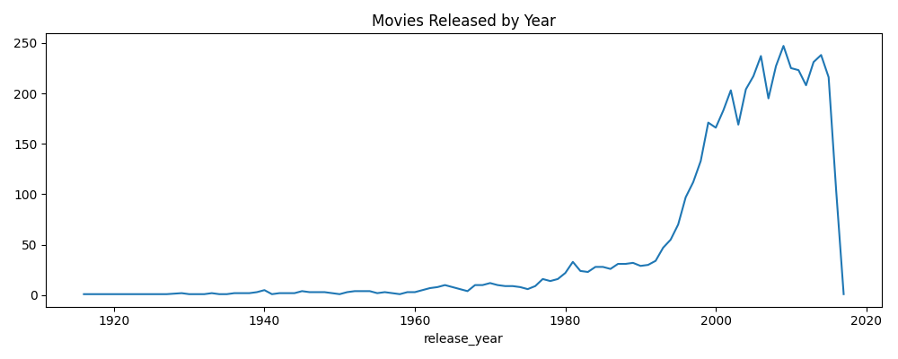
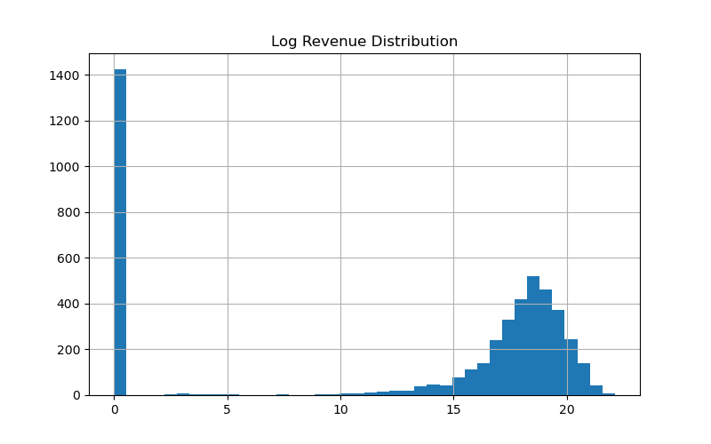
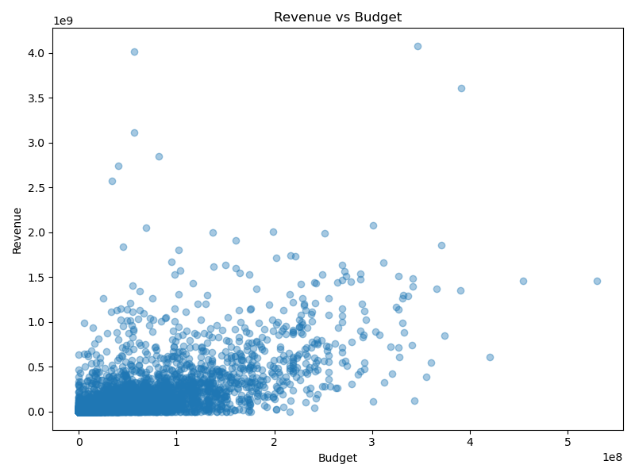
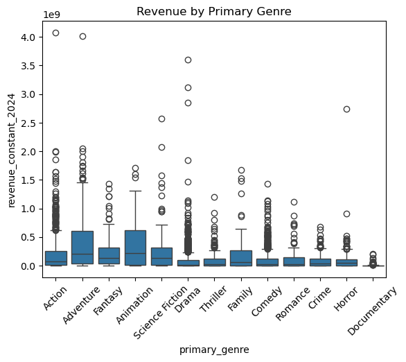
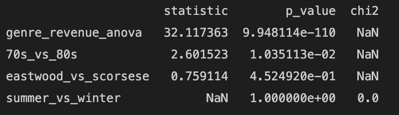
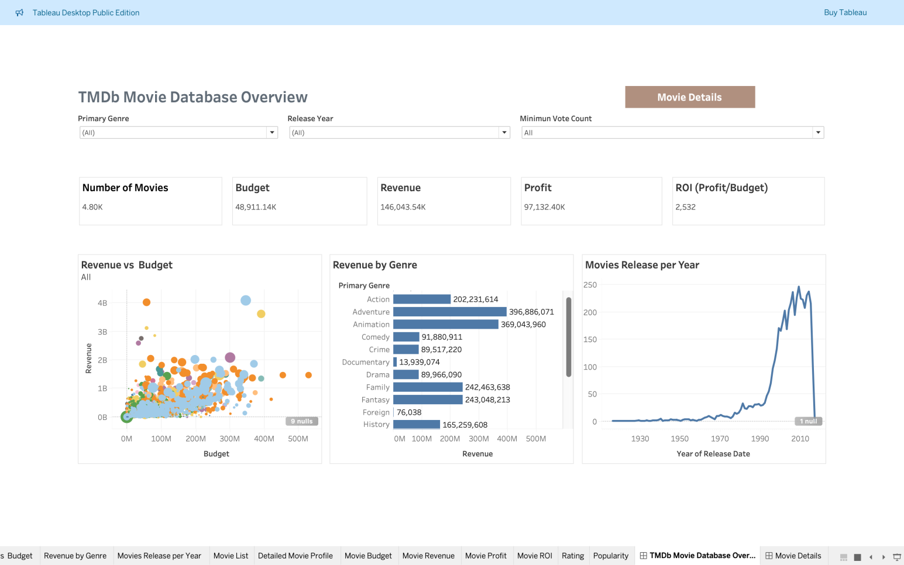
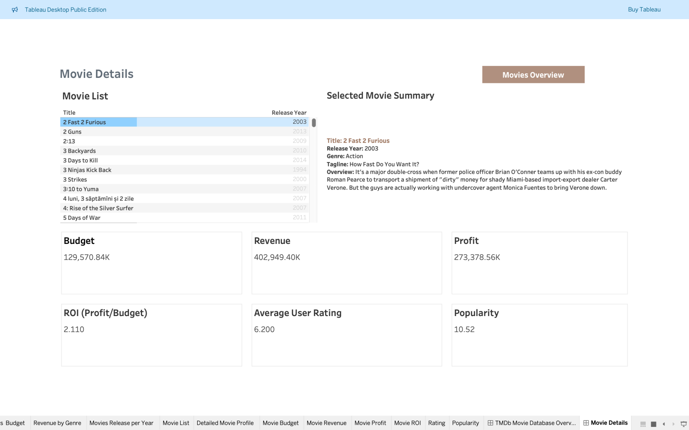

# Movie Revenue Analysis

A statistical analysis of 4,800+ movies from the TMDB 5000 dataset. It looks at what is associated with box office revenue, such as genre, release decade, director, and release season. The project integrates and cleans the raw data, adjusts budget and revenue for inflation, tests hypotheses with ANOVA, t-tests, and chi-square, and presents the results in a Tableau dashboard.

Group project for ISE 521 at the University of Southern California (Fall 2025), completed by a team of four.

## Workflow

| Step | Script | What it does |
| --- | --- | --- |
| 1 | [`01_data_preparation.py`](src/01_data_preparation.py) | Loads the movies and credits files, parses JSON columns, merges them, engineers features, and converts money to constant 2024 USD |
| 2 | [`02_eda.py`](src/02_eda.py) | Plots release trends, the revenue distribution, revenue vs. budget, and revenue by genre |
| 3 | [`03_statistical_tests.py`](src/03_statistical_tests.py) | Runs ANOVA, two t-tests, and a chi-square test |
| 4 | Tableau | Two-page interactive dashboard (screenshots below) |

## Data

The raw data is not included in this repository. To run the code, download these files into a `data/` folder:

- [TMDB 5000 Movie Dataset](https://www.kaggle.com/datasets/tmdb/tmdb-movie-metadata) (Kaggle): `tmdb_5000_movies.csv` (4,803 movies, 20 columns) and `tmdb_5000_credits.csv` (cast and crew in JSON format)
- [CPIAUCSL](https://fred.stlouisfed.org/series/CPIAUCSL) (FRED): the U.S. Consumer Price Index, used for the inflation adjustment

## Data preparation

- Parsed the JSON columns (`genres`, `keywords`, `cast`, `crew`) and merged movies with credits on `movie_id`.
- Engineered features: release year and season, primary genre, number of genres, director, top 3 cast, profit (revenue − budget), and ROI (profit ÷ budget).
- Converted budget, revenue, and profit to constant 2024 USD using annual average CPI, so films from different decades can be compared.

## Exploratory analysis

| | |
| --- | --- |
|  |  |
|  |  |

- Most movies in the dataset were released after 1990.
- Revenue is heavily right-skewed: a small number of films earn far more than the rest.
- Revenue generally rises with budget, but with wide variation at every budget level.
- Adventure and Animation have the highest median revenue among the major genres.

## Statistical tests

All tests use inflation-adjusted revenue and a 0.05 significance level.

| Test | Question | Statistic | p-value | Result |
| --- | --- | --- | --- | --- |
| One-way ANOVA | Does mean revenue differ across primary genres? | F = 32.12 | 9.95 × 10⁻¹¹⁰ | Significant |
| Welch's t-test | Does mean revenue differ between 1970s and 1980s films? | t = 2.60 | 0.010 | Significant |
| Welch's t-test | Does mean revenue differ between Clint Eastwood and Martin Scorsese films? | t = 0.76 | 0.452 | Not significant |
| Chi-square | Are summer and winter releases equally common? | — | — | See note below |



**What the results show**

- **Genre:** genre is strongly associated with revenue. The ANOVA shows that at least one genre differs; a post-hoc test such as Tukey's HSD would be needed to say which genres differ from each other.
- **Decade:** the positive t-statistic means 1970s films in this dataset earned more on average than 1980s films in constant dollars. The dataset includes relatively few 1970s films, so this may reflect which older films are included more than the decade itself.
- **Director:** there is no significant difference in average revenue between Clint Eastwood and Martin Scorsese films.

**Note on the chi-square test:** the original analysis reported χ² = 0.0 and p = 1.000. That result came from the method, not the data: it passed a single-row table to `chi2_contingency`, which always returns χ² = 0 and p = 1 whatever the counts are. The script now uses a chi-square goodness-of-fit test (`scipy.stats.chisquare`), which is the appropriate test for comparing two counts. The corrected test has not been re-run, so no corrected result is reported here.

## Dashboard

The Tableau dashboard has two pages: an overview with filters for genre, release year, and vote count, and a movie details page for exploring individual titles.





## Running the code

```bash
pip install -r requirements.txt
# Place the three data files in data/
python src/01_data_preparation.py
python src/02_eda.py
python src/03_statistical_tests.py
```

## Notes and limitations

- The code was assembled from the project's final presentation. Some helper functions (`safe_load_json`, `extract_director`, `extract_top_cast`, `determine_season`, `extract_primary_genre`) were referenced but not shown there, so they were rewritten from their documented purpose and are marked in the code. Results from re-running the code may differ slightly from the original results reported above.
- Many movies in TMDB have a budget or revenue of 0, which usually means the value is missing rather than truly zero. These rows were kept in the original analysis, as the spike at 0 in the log revenue chart shows. Excluding them would make the revenue comparisons more reliable.
- The primary genre is the first genre listed for each movie, so movies with several genres are counted only once.

## Team

Wendi Zhang, Lilian Lee, Ganlu Sun, and Yuchen Ji — ISE 521, University of Southern California.
